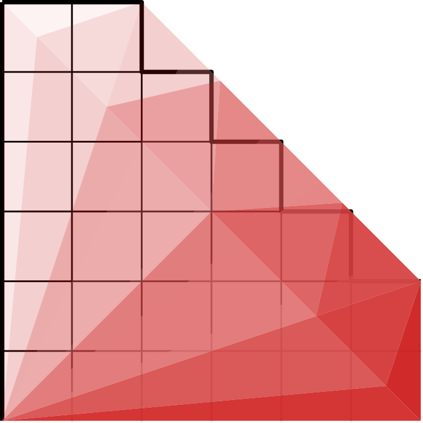

<picture>
  <source media="(prefers-color-scheme: dark)" srcset="doc/gemmstone_dark.png">
  <source media="(prefers-color-scheme: light)" srcset="doc/gemmstone.png">
  
</picture>

# gemmstone: GEMM for Intel GPUs

This repository is home to gemmstone, a just-in-time (JIT) kernel generator for matrix multiplication (GEMM) and related routines on Intel GPUs. gemmstone uses [nGEN](https://github.com/uxlfoundation/oneDNN) to create kernels directly in assembly, with no dependencies on IGC/vISA.

gemmstone is used internally in oneMKL for BLAS level-3 routines, and in [oneDNN](https://github.com/uxlfoundation/oneDNN) for matmul and inner product primitives, as well as inside several multi-GEMM fusions (RNN, SDPA).

## Supported Hardware

gemmstone supports the following Intel GPUs:

| Type | Graphics Core(s) | Products                                                             |
| ---- | ---------------- | -------------------------------------------------------------------- |
| 12LP | XeLP             | TGL/ADL/RKL; DG1 (Xe MAX) discrete GPUs                              |
| 12HP | XeHP             | ATS-P (not publicly released)                                        |
| 12p7 | XeHPG/XeLPG      | DG2 (Arc), ATS-M (Flex), MTL, ARL                                    |
| 12p8 | XeHPC            | PVC (Max)                                                            |
| Xe2  | Xe2              | BMG, LNL                                                             |
| Xe3  | Xe3              | PTL, NVL *(S, U, H, HX)*                                             |
| Xe3p | Xe3p             | NVL-P, CRI                                                           |

## What's Here?

gemmstone consists of several major components:

* A [**kernel generator**](generator) for GEMM and related routines. The generator is highly parameterized, creating kernels based on a set of strategy parameters.
* [**Kernel catalogs**](selector/db) containing pre-tuned strategies for the generator, specialized by architecture, data type, memory format, alignment, and other factors.
* A [**kernel selector**](selector) that consults the kernel catalogs to find appropriate strategy parameters for a specific GEMM problem, predicting the performance of candidate strategies based on the matrix dimensions, GPU configuration, etc.
* The [**microkernel provider**](generator/microkernel_selector.cpp) creates GEMM *microkernels* that can be called as a subroutines from kernels written in high-level languages (OpenCL, SYCL, etc.), with help from the [microkernel service library](https://github.com/uxlfoundation/oneDNN).

These components are the "production side" of gemmstone, and are embedded inside oneMKL and oneDNN. In addition, gemmstone comes with a number of development tools:

* `frontend`: a command-line interface to the kernel generator, producing kernels in assembly text (with comments) or directly as binaries.
* `benchstone`: functional and performance testing tool for individual kernels, running under either OpenCL or Level Zero.
* `ktool`: cataloging and kernel selection tool, also offering automated kernel testing and kernel performance modeling.
* `multiderby`, `pvc_derby`: autotuners that identify good kernel strategies for a range of matrix sizes.

Here's an illustration of how the tools work together in a development flow:


## Getting Started

To start using gemmstone, you'll need:

* A machine with a compatible Intel GPU (real or simulated), with OpenCL and Level Zero runtimes.
* A C++17-capable compiler; any reasonably recent compiler should work.
* [CMake](https://cmake.org/), version 3.18 or later.
* [nGEN](https://github.com/uxlfoundation/oneDNN): JIT assembler for Intel GPUs.
* [OpenCL](https://github.com/KhronosGroup/OpenCL-Headers/) and [Level Zero](https://github.com/oneapi-src/level-zero) headers.

You may also want:

* [MKL](https://www.intel.com/content/www/us/en/developer/tools/oneapi/onemkl-download.html). Any version is fine, and GPU support is not required.
  - *Note*: `ktool` requires MKL to add new kernels. `benchstone` and `pvc_derby` will use MKL if present to improve CPU performance.
* IGA (Intel Graphics Assembler), to assemble generated kernels manually.
  - The `iga64` binary may already be installed on your system as part of the GPU drivers.

gemmstone supports both Linux and Windows, although some tools (`ktool`, `multiderby`, and `pvc_derby`) are Linux-only at present.

### Build Steps

```sh
# nGEN and gemmstone both ship inside oneDNN. Clone oneDNN to get nGEN:
git clone https://github.com/uxlfoundation/oneDNN

# Build gemmstone (and its tools) standalone from within the tree:
cd oneDNN/src/gpu/intel/gemm/jit
mkdir build && cd build
cmake ..
cmake --build .
```

nGEN ships with oneDNN under `third_party/ngen` and is found automatically. To
use a different nGEN, set `-DNGEN_ROOT=/path/to/ngen/parent`.

By default, gemmstone will build generators for all supported architecture types. The optional `GPUS` configuration variable allows you to build for specific architecture(s), using codes from the [list](#supported-hardware) above:
```sh
cmake -DGPUS="12p8;Xe2" ..       # build only for XeHPC and Xe2
```

After a successful build, the command-line tools and some helper scripts will be placed in the top level of the build folder.

### Generating and Running a Kernel

Let's start by finding a kernel for a 4k square SGEMM. We'll assume no transposition for A/B (NN case).

The example output here comes from a 448 EU PVC machine. On a different GPU, the output may look different but the same steps apply.

```sh
$ cd /path/to/gemmstone/build

# Ask ktool to rank candidate kernels for m = n = k = 4096.
#   SSS means A/B/C are single precision ('S')
#   NNN means A/B/C are not transposed ('N')
$ ./ktool -e 4096x4096x4096 gemm SSS NNN
Cost         Kernel
4.3221e+09   #1067 gemm SSS NNN 64 16 1 0 aB8x2+B16@8 aS8x2+S32@8 aB wg 2x8x2 kr kc8 nse hi pt sr kv sb256 bk0 sn grf256 afb np     (global k-slicing: variable)
4.36231e+09  #1066 gemm SSS NNN 64 32 1 0 aB8/4+B8@32 aS8+S1,16@32 aB nse wg 4x8 bo pt kc8 sn sb256 grf256 bk0 sr kv afb np         (global k-slicing: variable)
...
```

(For Windows, convert forward slashes to backslashes as needed.)

`ktool` is showing us all available strategies in the catalog for this SGEMM, arranged from fastest to slowest (predicted). The strategies are listed in a compressed string format described [here](doc/frontend.md). The compressed format takes some mastering but allows for easy modification and manipulation when trying out different strategies.

Let's generate assembly for the top strategy. We'll use the assembly-text frontend, `frontend`.

```sh
$ ./frontend gemm SSS NNN 64 16 1 0 aB8x2+B16@8 aS8x2+S32@8 aB wg 2x8x2 kr kc8 nse hi pt sr kv sb256 bk0 sn grf256 afb np
<lots of assembly text>
```

Now let's run it. To prepare a kernel for benchmarking, use the `oprep.pl` script (`oprep.bat` for Windows):

```sh
$ ./oprep.pl gemm SSS NNN 64 16 1 0 aB8x2+B16@8 aS8x2+S32@8 aB wg 2x8x2 kr kc8 nse hi pt sr kv sb256 bk0 sn grf256 afb np
```

The kernel is now available in a temporary location for use by future `benchstone` runs. Let's start with some accuracy testing:

```sh
# Run a standard suite of accuracy checks
$ ./benchstone -a
Using OpenCL device Intel(R) Data Center GPU Max 1100 (XeHPC, 1x56x8 = 448 EUs, 1550 MHz).
Testing kernel gemm SSS NNN 64 16 1 0... OK

# Check our specific size, using -v to display more output
$ ./benchstone -a 4096x4096x4096
Using OpenCL device Intel(R) Data Center GPU Max 1100 (XeHPC, 1x56x8 = 448 EUs, 1550 MHz).
Testing kernel gemm SSS NNN 64 16 1 0
Size is 4096 x 4096 x 4096, leading dimensions 4128, 4128, 4128
Size is 4096 x 4096 x 4096, leading dimensions 4128, 4128, 4128
Size is 4096 x 4096 x 4096, leading dimensions 4128, 4128, 4128
Size is 4096 x 4096 x 4096, leading dimensions 4128, 4128, 4128
OK
```

We could have used `benchstone --level-zero` instead to run with Level Zero, rather than OpenCL.

Accuracy looks good, so let's move to performance:

```sh
$ ./benchstone -p 4096x4096x4096
Using OpenCL device Intel(R) Data Center GPU Max 1100 (XeHPC, 1x56x8 = 448 EUs, 1550 MHz).
Testing kernel gemm SSS NNN 64 16 1 0
Size is 4096 x 4096 x 4096, leading dimensions 4128, 4128, 4128
              Blocking: 4096x4096x4096, 1x1x1 blocks
          Thread group: 2x8x1 (?x-xK)
    Variable k-slicing: slicing final 128 group(s) with k chunk size = 4720
          Average time: 6.24155ms (6 repetitions) -- std. deviation: 24.8388us
           Actual GB/s: 32.26
          Actual GOp/s: 22020.0
            Peak GOp/s: 22220.8
    Nominal efficiency: 99.1%
```

This strategy uses a 64x16 per-thread tile size (that's the `64 16` part near the beginning of the strategy). As an experiment, let's see what happens if we shrink it to 16x8:

```sh
$ ./oprep.pl gemm SSS NNN 16 8 1 0 aB8x2+B16@8 aS8x2+S32@8 aB wg 2x8x2 kr kc8 nse hi pt sr sb256 bk0 sn grf256 afb np
$ ./benchstone -p 4096 4096 4096
Using OpenCL device Intel(R) Data Center GPU Max 1100 (XeHPC, 1x56x8 = 448 EUs, 1550 MHz).
Testing kernel gemm SSS NNN 16 8 1 0
Size is 4096 x 4096 x 4096, leading dimensions 4128, 4128, 4128
              Blocking: 4096x4096x2048, 1x1x2 blocks
          Thread group: 2x8x2 (?x-xK)
          Average time: 7.79448ms (6 repetitions) -- std. deviation: 126.991us
           Actual GB/s: 25.83
          Actual GOp/s: 17632.9
            Peak GOp/s: 22220.8
    Nominal efficiency: 79.4%
```

Efficiency has dropped from ~99% to ~79% as a result of this change, reflecting the general trend that larger tile sizes are advantageous for large C matrices.

Of course, this is just the start -- there are many other strategy parameters to experiment with.

> [!NOTE]
> While gemmstone supports both row-major and column-major layouts, the kernel catalogs are column-major.
>
> To convert between row- and column-major GEMMs, swap the A and B matrices and the m and n dimensions.


## Documentation

You can find an introduction to the gemmstone codebase and tooling in this presentation, alongside other GPU GEMM-related documentation. Documentation on some of the algorithms used within gemmstone can be found [here](doc/algorithms).

More detailed information on the individual tools is available in their respective pages:

* [`frontend`](doc/frontend.md) and strategy syntax
* [`benchstone`](doc/benchstone.md)
* [`ktool`](doc/ktool.md)
* [Autotuners](doc/autotuners.md) (`multiderby`, `pvc_derby`)

`frontend`, `ktool`, and `multiderby` also have command line help available (run with `--help`).

gemmstone's programmatic interface (as used by oneMKL/oneDNN) can be found in the [include](include) folder.
