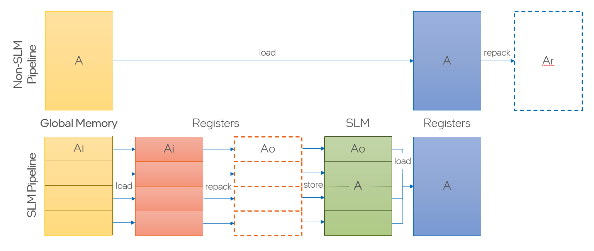

k-Loop Pipelines
================

The inner k-loop is the heart of a GEMM-like kernel, computing $C\leftarrow C + A\cdot B$ for a fixed-size tile $C$ and panels $A$, $B$. Much of the performance of the k loop comes from a well-optimized pipeline bringing A/B tiles from global memory into registers, in a format suitable for computation.

gemmstone implements a very flexible pipeline generator, providing a wide space of configuration options for manual tuning or autotuning.


Basic Pipelines
---------------

The simplest possible k-loop pipeline is:

```
for h = 0 ... k - 1:
   load A_h = column h of A from global memory
   load B_h = row h of B from global memory
   outer product C += A_h*B_h
```

To improve memory/cache efficiency, it is usually advantageous to load multiple columns of A and multiple rows of B at a time. These k chunk sizes are specified in `GEMMStrategy::{ka,kb}_load`. The k chunk sizes also need to be chosen large enough to provide data for the compute operation, if not using plain FMAs. For dp4a, `ka_load`/`kb_load` need to be a multiple of 4, while for DPAS the k chunk sizes are much larger (8&ndash;64 depending on data types). In addition, compute operations can sometimes be chained together in the k dimension (e.g. with accumulator registers for FMA, or via `{Fwd}` for DPAS). Internally, gemmstone expresses this compute granularity via [`outerProductCount`](../../generator/pieces/compute_utils.hpp). 

Note that `ka_load` and `kb_load` need not be equal. For instance, if A and B are both column-major, then `kb_load` can be made larger (to load full cache lines of B, for instance), while leaving `ka_load` smaller in order to reduce register pressure. In this case, A and B loads will simply occur at different frequencies in the k loop.


Multibuffering/Prefetch
-----------------------

One key limitation of the simple k-loop pipeline is the lack of latency absorption. Global memory loads have a long latency (hundreds to thousands of cycles), and the EU will stall while waiting for data to arrive if this latency is not covered. The most basic latency coverage is via hyperthreading (multiple threads running simultaneously on an EU), but hyperthreading alone is often insufficient.

One mechanism for absorbing latency is to maintain multiple register buffers for A/B data (`GEMMStrategy::{A,B}_copies}`). Each A load is directed to the most recently consumed A register buffer, allowing the load to run in parallel with `ka_load` * (`A_copies` - 1) outer products (similarly for B). The tradeoff is additional register and token pressure. Typically multibuffering is most useful for column-major A and row-major B.

Starting in PVC, another method for latency absorption is prefetching data to L1/L3 cache. L1 prefetch in gemmstone is controlled by three parameters:

* `prefetchA`/`prefetchB`: prefetch distance, in units of k
* `ka_prefetch`/`kb_prefetch`: number of columns to prefetch at once
* `ka_pfStride`/`kb_pfStride`: k distance between adjacent prefetches (defaults to `{ka,kb}_prefetch` but can be larger -- e.g. for row-major A it isn't necessary to prefetch every element, just one in every cache line)

Note that gemmstone does not limit prefetch distance to whole k loops; it can be fine-tuned as needed. L1 prefetching is a workgroup-cooperative operation, with each thread prefetching a subset of the full A tile. This partitioning is controlled by the `coop{A,B}` parameters (see [Data Splitting](#data-splitting) below).

Prefetching and multibuffering can be combined arbitrarily in gemmstone.


Repacking/Dequantization
------------------------

In some cases, the data from global memory can be read directly into registers in the format and layout needed by the compute operation. However, in many cases, some preprocessing of the data is required: shuffling data in registers, data type conversion, or dequantization (applying scales or offsets/zero points). gemmstone collectively refers to these different kinds of preprocessing as _repacking_. Where necessary, separate A/B repack buffers are allocated with the layout and data type needed by the compute operation. Repack buffers are automatically sized, or the block size can be overridden with `GEMMStrategy::{ka,kb}_repack`. Note that only one repack buffer is used for each of A/B, regardless of any multibuffering for loads.


SLM Pipelines
-------------

An SLM pipeline may be viewed as a modification of the basic pipeline where the global-to-registers load and repack of A and/or B is thread-cooperative, instead of being performed by each thread. To enable cooperation, the A/B global data is partitioned between threads. Each thread loads its block of the partition, repacks it if necessary, then writes it to SLM. Finally, all threads read the data they need back from SLM. Data is stored in SLM to match the layout requirements of the compute operation (FMA/dp4a/dpas), so that threads can bring back data from SLM using efficiently large block loads.



SLM pipelines may be enabled/disabled separately for A/B, as needed (`GEMMStrategy::slm{A,B}`). The k chunk size for SLM A/B buffers is controlled by `GEMMStrategy::unrollKSLM`, and is common for A/B.

> [!TIP]
> As shown in the diagram, the gemmstone code internally uses `Ai`/`Bi` to refer to a single thread's slice of the SLM tile when being loaded from global memory, and `Ao/Bo` to refer to that slice (after any repacking) when being stored to SLM. Plain `A`/`B` refers to the full tile loaded from SLM.

When multiple threads share data via SLM, it is necessary to use both workgroup barriers and proper SLM memory fences to properly synchronize SLM reads and writes. This synchronization can create a significant amount of overhead, especially when there is only 1 workgroup per XeCore &mdash; since then (almost) all the threads on every EU must stall at each barrier completion, starving all compute pipelines. To minimize the synchronization overheads, A/B data in SLM should be multibuffered (`GEMMStrategy::slmBuffers`). This reduces the amount of synchronization required between threads, as follows:

| SLM buffers | Synchronization required per buffer |
| - | - |
| 1x | 2 barriers |
| 2x | 1 barrier |
| 3x | 1 split barrier |
| 4x | 1 (nearly fully) split barrier |

More than 4 SLM buffers are possible, though not implemented in gemmstone. (To take advantage of additional buffers, named barriers would be required.) In practice, though, quadruple SLM buffering almost completely removes synchronization overheads, and typically triple buffering is sufficient.

The following table provides details on the pipelines for each buffering scheme. Warmup/cooldown are omitted, as are global memory loads.

| SLM buffers | Pipeline |
| - | - |
| 1x | $L_0\ M\ B_s\ B_w\ S_0\ F\ B_s\ B_w$ |
| 2x | $L_n\ M\ B_s\ B_w\ S_n\ F$ |
| 3x | $L_n\ M\ B_w\ S_{n+1}\ F\ B_s$ |
| 4x | $L_n\ M\ B_w\ F\ B_s\ S_{n+2}$ |

| Abbreviation | Meaning |
| - | - |
| $L_n$ | Read SLM buffer $n$ |
| $S_n$ | Write SLM buffer $n$ |
| $M$   | Compute |
| $B_s$ | Signal barrier (arrive) |
| $B_w$ | Wait on barrier |
| $F$   | SLM memory fence |

In addition to SLM multibuffering, global memory loads may be prefetched and/or separately multibuffered (controlled via `GEMMStrategy::slmCopies`) in registers.
It can also be useful to multibuffer the SLM loads, i.e., maintain multiple register buffers for data loaded from SLM, and load data from SLM one or more blocks ahead of the compute (`GEMMStrategy::{A,B}_copies`). Regardless of the use of register multibuffering, the basic synchronization structure shown above remains the same.

### Data Splitting

For SLM pipelines, gemmstone usually automatically determines how to split the global memory A/B tiles between participating subgroups (encoded in `GEMMStrategy::coop{A,B}`). Currently implemented splittings are:
* `CoopSplit::K`: partition in the `k` dimension
* `CoopSplit::MN`: partition in the `m` dimension (for A) or `n` dimension (for B)
* `CoopSplit::Linear`: (packed A/B only) partition in linear memory order
In all cases, partitioning happens on thread-sized tile of A/B. Partitioning is performed among all the threads that need that tile. (For instance, for `4x8` threads per workgroup, there are 8 threads sharing each A tile.)

### Named Barriers

gemmstone can optionally use named barriers to further reduce synchronization costs. This is most helpful when triple/quadruple buffering can't be used, due to limited SLM capacity. With named barriers, gemmstone can set up separate barriers for each row/column of threads. The idea here is that for an A SLM copy (for instance), only the threads within a row of threads needs to cooperate on the copy &mdash; they don't need to synchronize with any other threads in the workgroup. The `nb MxN` modifier sets up `M` named barriers in the `m` dimension (respectively `N`/`n`).


Periodic Barriers
-----------------

The barriers used in SLM pipeline can lead to overhead from extra stalls, but also has the benefit of ensuring that threads in a thread group stay roughly together (in the k dimension).
Without barrier usage, _thread drift_ can occur, with some threads racing ahead while others lag behind. Eventually, this drift leads to L1 thrash and catastrophic performance drops as k grows. To combat thread drift, gemmstone can insert periodic (split) barriers in the k loop to ensure threads do not drift too far apart. The k distance between barriers is tunable via `GEMMStrategy::barrierFreq`, and should be chosen to be small enough to avoid drift-related performance drops, but not too small, to avoid unnecessary performance overhead.

Named barriers can also be used for the periodic barriers, with the same syntax as for SLM.


Loop Sequencer
--------------

Orchestrating deep pipelines &mdash; especially with significant multibuffering and different settings for A/B &mdash; is a complex task. This complexity is further increased by the need to handle k remainders, which often involves reducing tile sizes, switching load/store message types, and control flow for out-of-bounds checks on k. To generate these pipelines, gemmstone has a dedicated [_loop sequencer_](../../generator/pieces/loop_sequencer.hpp) component that programmatically synthesizes warmup/main/cooldown/short/remainder loops. Each task in the k loop (load A, outer product, etc.) is declared as a `LoopSequencer::Item` &mdash; a combination of a set of _requirements_, expressing the task's logical position in the pipeline, and an _action function_, called when that task should be fired.

Task timing is anchored by _trigger points_ within the loop iteration space $k\in [h_0, h_1)$. For the k loop, trigger points are usually aligned with the execution of the outer product to which this task is contributing. For instance, an SLM store is triggered by the outer product operation that will eventually use that SLM store's data, though the actual execution of the SLM store happens much earlier in time (this is called _lookahead_).

A task's requirements are embodied in `LoopSequencer::Requirements`, which includes:
* `period`: how often the action should be triggered
* `phase`: trigger this action when `(k % period) = phase`
* `lookahead`: action will run this many iterations before the trigger point
* `duration`: the number of guaranteed loop iterations, starting at the trigger point, that are required for this action

The `duration` parameter is used for remainder handling. For instance, if `ka_load` = 8 (loading 8 columns of A at a time), the A load task will have a duration of 8, expressing the fact that we need 8 guaranteed iterations to execute this task. When `duration > 1`, the main `Item` may have backup `Item` instance(s) that are used in case not enough k iterations may be available for the main item. An `Item` may optionally have a _check function_, which gates execution of that item.

Each task is executed at iteration `(trigger point - lookahead)` of the loop (negative iteration numbers correspond to warmup iterations). In case of ties, tasks are executed in the order they are added to the `LoopSequencer`.
